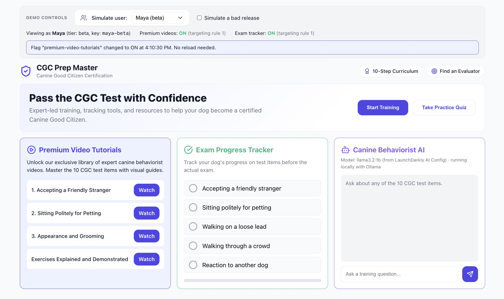
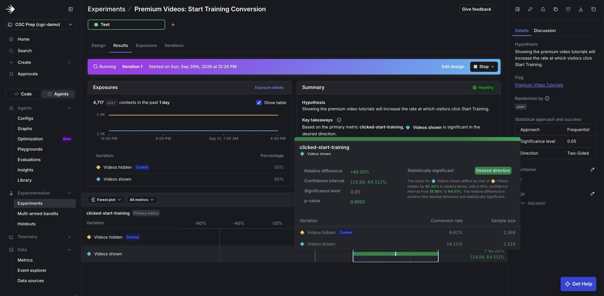

# Sit, Stay, Ship

*A LaunchDarkly demo: release a feature, roll it back, target it, test it, and let an AI Config pick the model.*

**The story.** CGC Prep Master is a made-up company that sells online prep courses for the AKC Canine Good Citizen dog test. Its team wants to ship a new "premium videos" feature without the usual risk: test it on a few customers first, turn it off instantly if it breaks, and only roll it out everywhere once the data says it helps. This app is their site, built to show how LaunchDarkly does each of those jobs.

| | |
|---|---|
|  |  |
| The feature, released and live. Toggling the flag in LaunchDarkly makes the card appear or vanish with no page reload. | The same feature, tested. Half of visitors saw it, half did not; LaunchDarkly measured whether it changed their behaviour. |

## Quick start

**You need:** Node.js 22.12+, [Terraform](https://developer.hashicorp.com/terraform/install) 1.5+ (macOS: `brew tap hashicorp/tap && brew install hashicorp/tap/terraform`), and a free [LaunchDarkly trial account](https://launchdarkly.com/start-trial/) (it includes experimentation, AI Configs and flag triggers). Optional: [Ollama](https://ollama.com/download) for real chatbot replies (`npm run ollama` installs it; without it the chatbot gives canned replies), and a New Relic account.

```bash
git clone https://github.com/Limalbert96/sit-stay-ship.git && cd sit-stay-ship
npm install
cp .env.example .env     # optional: setup asks for your API token if it is empty
npm run setup            # creates the cgc-demo project and everything in it; safe to re-run
npm run dev              # http://localhost:5173
```

`npm run setup` needs a LaunchDarkly **API access token** (LaunchDarkly, Account settings, Authorization, Access tokens, role **Admin**, starts with `api-`). Paste it when asked; it is checked and can be saved in `.env`, which is git-ignored. It is not the SDK key and the app never reads it.

Then generate some data (in a second terminal):

```bash
npm run simulate -- --target flag --users 5000   # experiment data (allow a few minutes for the Results tab)
npm run simulate -- --target ai --users 2000
npm run incident -- --auto-remediation           # needs Chrome and New Relic: a bad release that New Relic switches off by itself
```

Without `--auto-remediation`, `npm run incident` presses the kill switch itself. `--calm 30 --detect 60` shortens the run and `--dry-run` previews it.

**New Relic is optional.** Leave its lines in `.env` empty and everything else still works. To use it, fill in these (the rest of `.env` is written by setup):

| You provide | Where to get it |
|---|---|
| `NR_ACCOUNT_ID`, `NR_BROWSER_APP_ID`, `NR_BROWSER_LICENSE_KEY` | New Relic: Add data, Browser monitoring, copy/paste snippet |
| `NR_APM_LICENSE_KEY` | New Relic: Add data, Node.js |
| `NR_USER_KEY` | New Relic: profile menu, API keys, Create key, type **User** (lets setup wire LaunchDarkly and New Relic both ways, and enables auto-remediation) |

Slack is added by hand with [LaunchDarkly's Slack app](https://launchdarkly.com/docs/integrations/slack). If a setup step reports `[!]`, it says what to finish by hand; see the [manual setup](docs/manual-setup.md).

**Start over from scratch**

```bash
npm run teardown -- --dry-run   # preview: nothing is deleted
npm run teardown                # type the project key (cgc-demo) to confirm
npm run setup
```

| Command | What it does |
|---|---|
| `npm run setup` / `npm run teardown` | Create / remove everything the demo needs (LaunchDarkly, and New Relic if configured) |
| `npm run dev` | Starts the web app and the chat backend (and Ollama if installed) |
| `npm run simulate -- --target flag\|ai --users N` | Synthetic experiment traffic |
| `npm run incident [-- --auto-remediation]` | Plays out a bad release for the New Relic charts |
| `npm run newrelic` | Re-runs only the New Relic wiring; `--auto-remediation on\|off`, `--status` |
| `npm test` / `npm run lint` / `npm run build` | Unit tests, lint, production build |

The full list, every environment variable and the setup options are in [Setup in detail](docs/setup-details.md).

## Learn more

| | |
|---|---|
| [Demo storyline](docs/demo-storyline.md) | A 15-minute walkthrough in five acts, one per role |
| [Walkthrough](docs/walkthrough.md) | What each part shows: release and rollback, targeting, experimentation, AI Configs |
| [Integrations](docs/integrations.md) | Slack, Terraform, New Relic and automated remediation |
| [Feature map](docs/feature-map.md) | Every capability, matched to the file or screen that shows it |
| [How it fits together](docs/architecture.md) | Architecture, personas, tests, security notes, project layout |
| [Setup in detail](docs/setup-details.md) | What setup does, all options, environment variables, using your own project |
| [Manual setup](docs/manual-setup.md) | Everything setup creates, done by hand |
| [Troubleshooting](docs/troubleshooting.md) | Common problems and fixes |

## Keep secrets out of git

`.env`, Terraform state and `*.tfvars` are git-ignored; never commit them. The server-side SDK key, the API token, the New Relic keys and the kill-switch trigger URL are secrets. Only the client-side ID and the New Relic browser values reach the browser.
