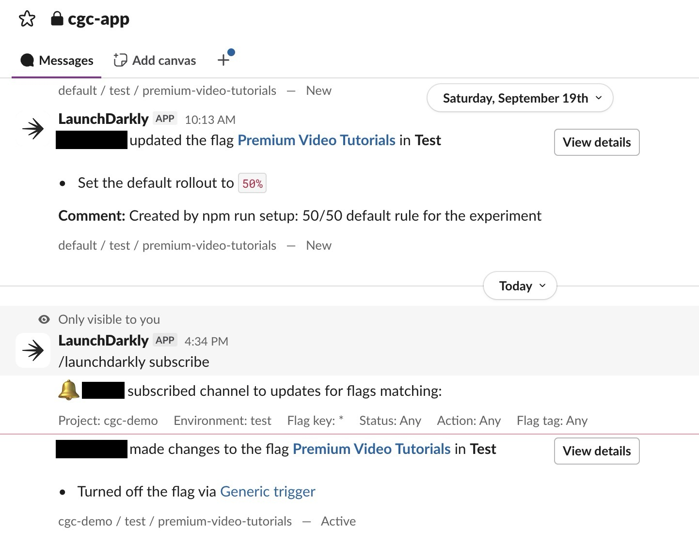
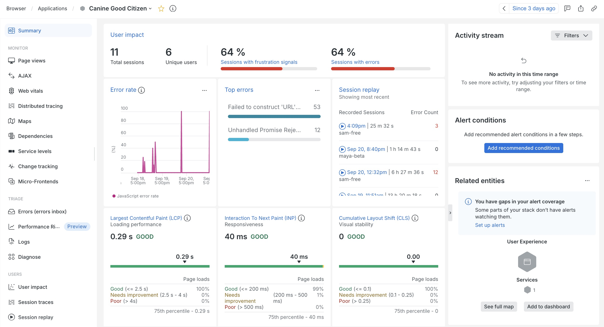
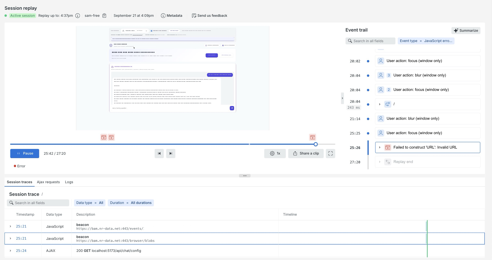
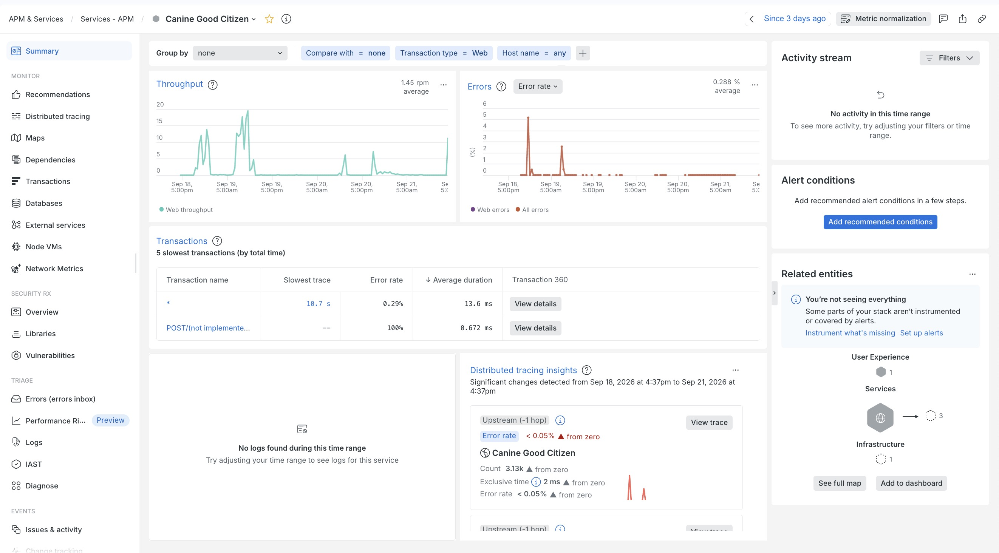
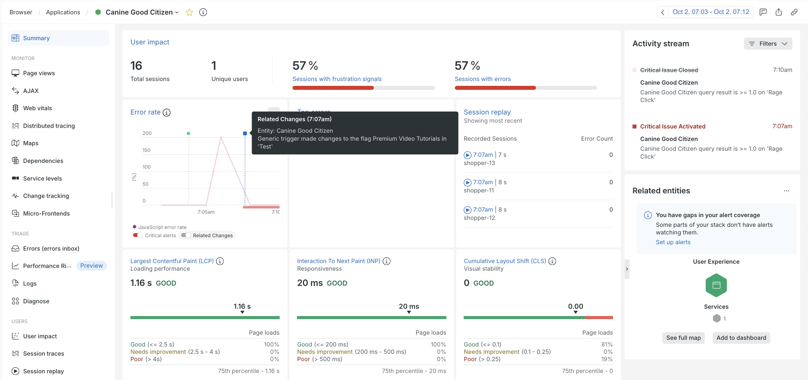
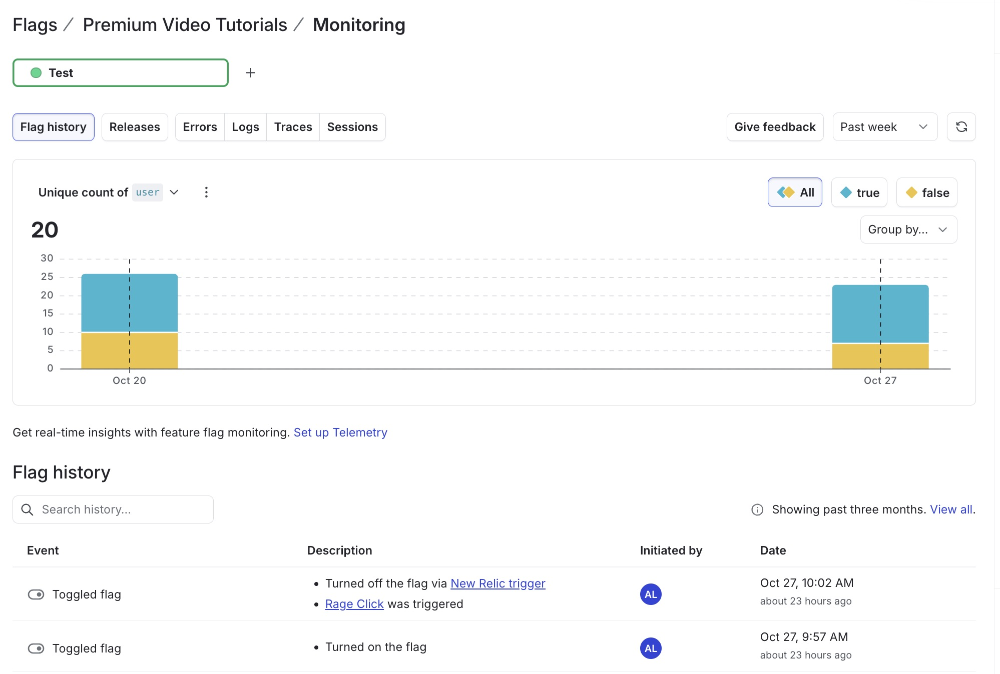

# Integrations

### Slack: flag change notifications

Setup does not do this one: it is added by hand with LaunchDarkly's Slack app (about 2 minutes). See LaunchDarkly's [Slack integration docs](https://launchdarkly.com/docs/integrations/slack).

1. LaunchDarkly: Organization settings (gear icon), Integrations, **Slack**, Add integration.
2. Authorize your workspace and pick a channel.
3. **Test it:** change any flag in LaunchDarkly (for example toggle `exam-progress-tracker`). A message appears in the channel within seconds, showing who changed what. Firing the flag trigger posts there too, which makes the remediation demo easy to follow.

`npm run teardown` does not remove this integration, because you added it by hand. Delete it under Organization settings, Integrations, Slack.

What a flag change looks like in the Slack channel (names hidden), including the trigger firing:



### New Relic (optional): browser and APM agents

You create the New Relic account and its Browser and APM applications yourself, and put their values in `.env` (with none set, both agents stay off and the app runs normally). With `NR_USER_KEY` in `.env` as well, `npm run setup` wires the rest: the change-tracking integration (step 3 below) and the [automated kill switch](#automated-remediation-let-new-relic-pull-the-kill-switch-itself).

1. **Browser agent (the React app).** In New Relic add a Browser application and copy the IDs into `.env` (`NR_ACCOUNT_ID`, `NR_BROWSER_APP_ID`, `NR_BROWSER_LICENSE_KEY`). [`src/observability.js`](../src/observability.js) starts the agent, tags sessions with the user and the current flag value, and reports errors caught by the flag boundary (try **Simulate a bad release**). Confirm it under Browser monitoring; you can query `SELECT * FROM JavaScriptError WHERE appName = 'Canine Good Citizen'`.
2. **APM agent (the Node backend).** Copy the APM license key into `.env` as `NR_APM_LICENSE_KEY` (and keep `NR_APM_APP_NAME` the same as the Browser app's name). `npm run server` preloads the agent through `newrelic.cjs`; without a key it stays disabled. Set `NR_APM_AIM_ENABLED=true` to turn on New Relic's AI monitoring for the chatbot's model calls. Each chat request carries the persona and the model LaunchDarkly picked as custom attributes.

What it shows, after some bad-release clicks. The browser agent reports the errors the bad release causes (top errors: "Failed to construct 'URL'"), grouped by session and user:



Session replay lets you watch the session in which the error happened (text is masked, so typed chat text never leaves the browser):



The APM agent reports the Node backend:



3. **Change tracking: every flag change as a marker on New Relic's charts** (needs `NR_USER_KEY`). LaunchDarkly's New Relic integration (`new-relic-v2`) writes each flag change to New Relic as a **change tracking event of category `FEATURE_FLAG`**, so a "flag turned off" marker lines up with the error spike. `npm run setup` (or `npm run newrelic` on its own) creates it when `NR_USER_KEY` is in `.env`: a New Relic **user key** (profile menu, API keys, Create key, type **User**; the license and browser keys above cannot call NerdGraph).

   One subscription marks one New Relic application, so there are two, named after the entity: **`Canine Good Citizen [APM]`** and **`Canine Good Citizen [Browser]`**. Setup asks NerdGraph for each application's **entity.guid** by `NR_APM_APP_NAME` (so the APM and Browser apps must share that name), and gives it to the integration as `entityGuid`. Nothing to copy into `.env`. Two details the setup handles for you:
   - **All environments, one project.** The integration's default policy covers only the `production` environment, and this demo runs in `test`, so each subscription's policy is `proj/<project>:env/*:flag/*`.
   - **Created through the API, not Terraform**, because each subscription needs an entity.guid that only New Relic knows, at setup time. The step finds its subscriptions by name and updates them, so running it again is safe.

   In LaunchDarkly, Organization settings, Integrations, the two subscriptions show up under **New Relic**, both on, with a count of events delivered and no errors:

   ![LaunchDarkly Settings, Integrations: the Slack App, and New Relic with two configurations, Canine Good Citizen [APM] and Canine Good Citizen [Browser], both On with 14 success events and 0 errors](images/17-ld-integrations.jpg)

   Each event links back to LaunchDarkly (`launchdarklyAuditLogUrl`, `launchdarklyFlagUrl`) and says who changed what, for example `<your name> turned on the flag Premium Video Tutorials in 'Test' (via API), Comment: …`:

   ```sql
   SELECT shortDescription, user, launchdarklyAuditLogUrl FROM ChangeTrackingEvent WHERE launchdarklyProjectKey = 'cgc-demo' SINCE 1 day ago
   ```

   Both subscriptions work: each flag change lands on the APM and the Browser entity, so the marker shows on either app's charts. (This relies on the integration taking the entity's `entity.guid`, which setup looks up for you.)

   **Which kill switch fired?** The two kill switches are different trigger types: the page's button is a **Generic trigger** (its marker reads `Generic trigger made changes to the flag …`), and New Relic's is the **New Relic** trigger type. For the exact cause, follow `launchdarklyAuditLogUrl` from any marker in New Relic to LaunchDarkly's flag history. The page's button is a Generic trigger, which records the `eventName` it sends: **`Manual kill switch: pressed on the CGC Prep page was triggered`** (from [`server/index.js`](../server/index.js)). New Relic's is recorded as **`Turned off the flag via New Relic trigger`** and **`Rage Click was triggered`**, named after the alert condition (the workflow sends no `eventName`: this trigger type takes only `condition_name` and `incident_url`). [Screenshots below.](#automated-remediation-let-new-relic-pull-the-kill-switch-itself)

   **The whole incident on one chart.** Clicking through it by hand gives one session and a thin chart, so [`scripts/simulate-incident.mjs`](../scripts/simulate-incident.mjs) plays out the incident properly, with real customers and real time between the steps:

   ```bash
   npm run dev                               # in one terminal
   npm run incident                          # in another: about 10 minutes, the script presses the kill switch
   npm run incident -- --auto-remediation    # or: New Relic's alert presses it
   ```

   | Step | What happens |
   |---|---|
   | 1. Release | The flag is turned **on**. A flag-change marker lands on both entities. |
   | 2. Calm | A few customers browse the working page, so the chart has a healthy "before". |
   | 3. Bad release | A dozen customers meet the broken card and **rage-click** it, spread over a minute. |
   | 4. It burns | The feature stays on for a few minutes, the way a real incident waits to be noticed — long enough for an alert to fire. With `--auto-remediation`, until New Relic acts. |
   | 5. Remediate | The **kill switch** fires (with `--auto-remediation`, New Relic fires it). A second marker lands where the flag goes off. |
   | 6. Recovery | More customers arrive to a working page, so the chart shows traffic without errors. |

   The customers are real browser sessions: each is a separate headless Chrome with its own profile, so New Relic counts a distinct session and a distinct user, and the clicks are real mouse events, so they register as rage clicks and frustration signals. **Nothing is faked into New Relic** — the telemetry comes from the app's own browser agent, exactly as it would from a person. The visitors themselves are synthetic (premium-tier `shopper-NN`, marked `synthetic: true` in LaunchDarkly, and premium so they stay out of the trial-users experiment).

   **The alert.** With a condition on rage clicks (`SELECT uniqueCount(enduser.id) FROM UserAction WHERE rageClick = true AND appName = 'Canine Good Citizen'`, no facet, `CADENCE` aggregation, `>= 1` distinct customer), step 3 opens a real New Relic issue while the flag is still on, and step 5 is the fix. That is the whole loop an SE is asked about: ship, detect, remediate without a deploy. Why the alert is configured exactly this way (and why it closes on its own afterwards) is under [Automated remediation](#automated-remediation-let-new-relic-pull-the-kill-switch-itself).

   Timings are adjustable: `npm run incident -- --users 20 --calm 30 --detect 60`, and `--dry-run` prints the plan without touching anything. It needs `LD_API_TOKEN` and `LD_TRIGGER_URL` in `.env`, plus Chrome (`CHROME=/path/to/chrome` if it is not in the usual place). `--auto-remediation` also needs `NR_USER_KEY` and `NR_ACCOUNT_ID`, and the New Relic trigger's id, which it reads from this folder's Terraform state (or from `NR_TRIGGER_ID` in `.env` when there is none).

   

### Automated remediation: let New Relic pull the kill switch itself

The steps above are a person watching the alert and pressing **Fire kill switch**. The best practice once that works is to take the person out of the loop: a New Relic [Workflow](https://launchdarkly.com/docs/integrations/new-relic/triggers) fires a webhook the moment the rage-click alert opens an issue, and the webhook is a LaunchDarkly flag trigger of the **New Relic** type (`new-relic-v2`). Detection to remediation with no one awake. It is **off by default** here, so a live demo stays manual.

```bash
npm run newrelic                              # set it all up (npm run setup does this too); safe to re-run
npm run newrelic -- --status                  # is the automated kill switch on or off?
npm run newrelic -- --auto-remediation on     # let New Relic fire it
npm run newrelic -- --auto-remediation off    # back to manual (do this before a live demo)
npm run incident -- --auto-remediation        # rehearse it: on for this run only, off again afterwards
```

`npm run newrelic` ([`scripts/newrelic.mjs`](../scripts/newrelic.mjs), [`scripts/newrelic-lib.mjs`](../scripts/newrelic-lib.mjs)) creates, or adopts and fixes, everything by name, so it is safe on an account where some of it was made by hand:

| Object | Where | What it is |
|---|---|---|
| `new_relic_alert` trigger (Terraform) | LaunchDarkly, on `premium-video-tutorials` | Trigger type **New Relic** (`new-relic-v2`), action turn flag off |
| `Canine Good Citizen [APM]`, `[Browser]` | LaunchDarkly integrations | Flag changes into New Relic (see above) |
| `Rage Click` alert | New Relic alert policy | `SELECT uniqueCount(enduser.id) FROM UserAction WHERE rageClick = true AND appName = …`, `CADENCE`, empty windows filled with `0`, force-closes after 120s quiet |
| `LaunchDarkly kill switch (rage click alert)` | New Relic destination | Webhook to the New Relic trigger's URL |
| `LaunchDarkly kill switch webhook (workflows)` | New Relic channel | Sends `condition_name` (`{{ json accumulations.conditionName.[0] }}`) and `incident_url` (`{{ json issuePageUrl }}`), the only two fields LaunchDarkly's New Relic trigger accepts (flag history shows the alert condition's name, see below) |
| `Rage click -> LaunchDarkly kill switch` | New Relic workflow | Rage-click issues, on `ACTIVATED`; created **disabled** |

**What it looks like when New Relic pulls the kill switch** (`npm run incident -- --auto-remediation`). On the Browser summary, the Activity stream reads, from the bottom up: **Critical Issue Activated** (the rage-click alert opens), then **Feature Flag** `New Relic trigger made changes to the flag Premium Video Tutorials in 'Test'` under a minute later with no person involved, and finally **Critical Issue Closed** once the clicks stop. The error rate spike ends where the flag goes off:


Open the Feature Flag event for its change details. The description is `Turned off the flag via New Relic trigger` and `Rage Click was triggered`, and the key impacts show errors and logs dropping after the change:


And in LaunchDarkly the flag's **Monitoring** tab, Flag history, records the same thing from its side: the flag was turned on, then turned off via the New Relic trigger because Rage Click was triggered:



**It checks which trigger fired, not just that the flag changed.** `--auto-remediation` waits for the New Relic trigger's own `_lastTriggeredAt` to advance, rather than for the flag to merely go off: the flag can go off some other way too (a person pressing the page's button, or editing the flag directly), while New Relic is still deciding, and polling only "is it off" would wrongly credit New Relic for a change it had nothing to do with. Tested: it happened, once, before this check existed. If the timeout is reached, it says plainly whether the flag is off anyway (so you can tell "New Relic never fired" from "it fired but after the limit").

**Why a second trigger, not the same one.** LaunchDarkly flags support several triggers at once, each with its own one-time URL ([`terraform/main.tf`](../terraform/main.tf), `launchdarkly_flag_trigger.new_relic_alert`, output `new_relic_trigger_url`). The page's button keeps its own Generic trigger (`LD_TRIGGER_URL`); neither touches the other's URL, rate limit or history. If the trigger is ever re-created its URL changes; re-run `npm run newrelic` and the destination follows it.

**Why the New Relic trigger type.** It is LaunchDarkly's dedicated trigger for New Relic ([docs](https://launchdarkly.com/docs/integrations/new-relic/triggers)), and a different type from the page's Generic trigger, so the two paths stay easy to tell apart. In LaunchDarkly's trigger list it is **New Relic**; the entry marked **New Relic [Deprecated]** is the old `new-relic-apm` type. It needs a launchdarkly Terraform provider that knows `new-relic-v2` (see [Troubleshooting](troubleshooting.md#troubleshooting) if `terraform` rejects it).

**LaunchDarkly rate-limits trigger calls.** If the workflow's notification log in New Relic shows `429`, LaunchDarkly refused the call for coming too fast (repeated test notifications do this). Wait a few minutes before trying again.

**Why the alert closes now (it took three attempts to get right).** An alert that counts rage clicks gets *no data at all* once the kill switch works, because nobody can click a card that is gone, and that broke the issue closing in three different ways before landing on a config that actually works:
   - **Fill `NONE`** (the original config): no data means no value at all, so there's nothing to compare against the threshold. The issue stays open until the violation time limit (72 hours by default).
   - **`EVENT_TIMER` with fill `STATIC`/`0`** (looked right, tested live, was wrong): EVENT_TIMER only re-evaluates a window when a new event starts it, so once clicks stop there is no later window for the fill to apply to. Confirmed: stayed open 15+ minutes with zero new clicks.
   - **`CADENCE` with fill `STATIC`/`0`, `expiration` left at its default** (also looked right, also tested live, also wrong): `fillOption` fills a gap *within* a signal that is still reporting; it does nothing once the signal goes fully quiet (zero matching events, not even a non-matching one), which is exactly what happens between demo runs. Confirmed twice, on two different condition IDs: an issue stayed `ACTIVATED` for 12 and 33 minutes respectively, with the underlying query reading zero the entire time.
   - **`CADENCE` with fill `STATIC`/`0`, plus `expiration: { closeViolationsOnExpiration: true, expirationDuration: 120 }`** (what `npm run newrelic` sets): the `expiration` block is what governs a fully quiet signal, separately from `fillOption`. With it set, a genuinely quiet condition force-closes any open violation after the quiet gap passes. Confirmed live, twice: a stuck issue (already past the 12- and 33-minute marks above) closed within about a minute of this being applied.

   `npm run incident -- --auto-remediation` checks exactly this at the end of a run.

**Two gotchas, for building this by hand:** a Workflow can only attach to a channel whose `product` is `IINT` (an `ALERTS`-product channel fails with "unexpected error… fetching a channel"); and a faceted `EVENT_FLOW` rage-click condition never fires, because each customer sends one event ever and `EVENT_FLOW` waits for later data in the same series.

**Switch it off before a manual demo.** The alert opens an issue a minute or two after the rage clicks, and the workflow fires the moment it opens. If you mean to press **Fire kill switch** yourself, an enabled workflow can beat you to it. `npm run newrelic -- --status` tells you where it stands.

### Quick check of the New Relic integrations (no setup needed)

To find out in a minute or two whether both integrations work, without Terraform, a browser or the running app:

```bash
npm run check:newrelic                  # the whole check (about 1-4 minutes)
npm run check:newrelic -- --scratch     # always use a throwaway project, never the demo one
npm run check:newrelic -- --real        # fire the trigger URL the New Relic destination already holds
npm run check:newrelic -- --keep        # leave what it made, to look at in the UIs
npm run check:newrelic:cleanup          # remove what --keep (or a crashed run) left behind
```

It needs `LD_API_TOKEN`, `NR_USER_KEY` and `NR_ACCOUNT_ID` in `.env`, and the New Relic agents to have reported in once (so both applications exist). Nothing is faked: LaunchDarkly really turns a flag off and New Relic really receives the change events. It checks:

- **LaunchDarkly to New Relic:** a flag change arrives as a `ChangeTrackingEvent` on **both** the APM and the Browser application, on the `entity.guid` each subscription targets.
- **New Relic to LaunchDarkly:** a `new-relic-v2` trigger, fired with the body New Relic's workflow sends, turns the flag off, and LaunchDarkly records that trigger as fired.
- **The wiring** (when the demo project exists): the subscriptions are on, the rage-click alert, workflow, channel and destination exist, and the destination points at a trigger that still exists (it goes stale if the trigger is re-created).

When `cgc-demo` and its flag exist it checks those, and puts the flag back the way it found it. When they do not (nothing set up yet, or torn down) it builds its own: a scratch project `nr-check-xxxxxx` with one flag, a throwaway trigger, and two temporary subscriptions named `<app> (check xxxxxx) [APM]` and `[Browser]` aimed at your real applications, and deletes them all afterwards. The only lasting trace is a few change events on those two applications, which New Relic keeps. `npm run check:newrelic:cleanup` only ever touches `nr-check-` projects and those subscription names; do not use `npm run teardown` for this, it removes the real demo too. The full alert path (rage clicks, issue, workflow) is `npm run incident -- --auto-remediation`; this is the quick check that the two integrations themselves work.
