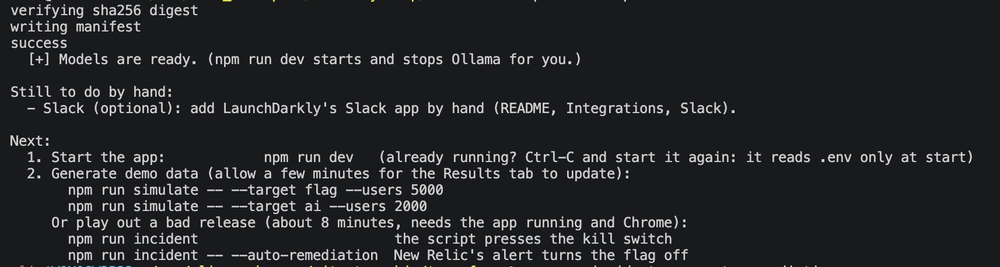
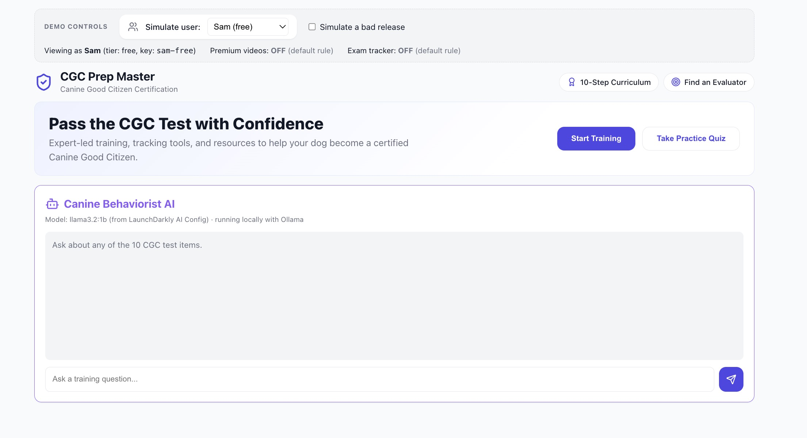

# Setup in detail

### 1. Prerequisites

- **Node.js 22.12 or newer** and npm (`node -v`).
- **[Terraform](https://developer.hashicorp.com/terraform/install)** 1.5 or newer (`terraform version`). On macOS: `brew tap hashicorp/tap && brew install hashicorp/tap/terraform`.
- A free **[LaunchDarkly trial account](https://launchdarkly.com/start-trial/)**. The trial includes the features used here (experimentation, AI Configs and flag triggers). A new account has a project called `default` with environments `test` and `production`. `npm run setup` leaves it alone and creates its own project, `cgc-demo`, with the same two environments, and uses `test`. To use an existing project instead, pass `--project <key>`.
- Optional, for real chatbot replies: **[Ollama](https://ollama.com/download)** (free, runs models on your machine, about 3.3 GB of downloads). `npm run ollama` installs it with Homebrew on macOS and downloads the models (no LaunchDarkly account or token involved); `npm run setup -- --install-ollama` does the same as its last step. Without Ollama the chatbot returns canned replies and everything else still works.
- Optional: a free New Relic account (browser and APM agents) and a Slack workspace (flag notifications).

### 2. Set up everything with one command

```bash
git clone https://github.com/Limalbert96/sit-stay-ship.git && cd sit-stay-ship
npm install
```

You need a LaunchDarkly **API access token**: LaunchDarkly, Account settings, **Authorization**, **Access tokens**, Create token, role **Admin** (setup creates the `cgc-demo` project, which a Writer token cannot; Writer is enough once the project exists). It starts with `api-`. This token is only for the scripts (setup, teardown, incident), through Terraform and the API. It is **not** the SDK key and the app never reads it.

```bash
npm run setup -- --dry-run            # optional preview: terraform plan, nothing is changed
npm run setup                         # add --install-ollama to install Ollama too
```

**The first time, `npm run setup` asks you for the token.** Paste it (the input is hidden); it checks the token with LaunchDarkly, and offers to save it in `.env` (git-ignored) so you are not asked again. If you would rather not be asked, set it yourself first: `export LD_API_TOKEN=api-xxxxxxxx`, or put `LD_API_TOKEN=...` in `.env`. `npm run teardown` works the same way. In a non-interactive shell (CI) there is no prompt, so set the variable.

`npm run setup` is safe to run again. It does four things:

1. **Terraform** (`terraform/`) creates everything in LaunchDarkly: the `cgc-demo` project if it does not exist yet; the flags `premium-video-tutorials` and `exam-progress-tracker` with descriptions, tags, the individual target `alex-vip`, the tier rule and a dark default (both turned on); the metrics `clicked-start-training` and `ai-response-helpful`; two flag **triggers** that turn the feature off (a Generic one for the page's kill switch, and a New Relic one for [automated remediation](integrations.md#automated-remediation-let-new-relic-pull-the-kill-switch-itself)); the AI Config `canine-coach-chatbot` with two local models and two variations.
2. **`.env`:** writes your environment's client-side ID, SDK key and the kill switch's trigger URL into `.env` (created from `.env.example` if missing).
3. **LaunchDarkly API:** Terraform has no resource for these, so the script serves the AI Config's two variations 50/50 (otherwise the chatbot would show "switched off") and creates **and starts** the two experiments: the flag on `clicked-start-training` and the AI Config on `ai-response-helpful`. Skip this with `--no-experiments`; running setup again retries it. With `NR_USER_KEY` in `.env` it also wires [New Relic](integrations.md#new-relic-optional-browser-and-apm-agents): the change-tracking integration, the rage-click alert and the automated kill switch (created off).
4. **Ollama:** starts it if needed and downloads the two local models (`llama3.2:1b`, `llama3.2:3b`).

Everything it creates is left **on** and ready: both flags are enabled, the chatbot works, and both experiments are running. The flag keeps a dark default, and its experiment runs on its own "trial users" rule (Jo and Riley), so the targeting demo stays predictable.

Options: `--project <key>` and `--env <key>` (defaults `cgc-demo` and `test`; a project that does not exist yet is created), `--dry-run`, `--install-ollama`, `--skip-models`, `--no-experiments`.

The **project key** is the short ID of your LaunchDarkly project (`cgc-demo` here; `default` in a new account), visible in LaunchDarkly URLs such as `.../projects/cgc-demo/...` and under Project settings. It is not the SDK key.

The script prints a summary. Anything marked `[!]` did not complete (for example a plan without flag triggers) and says what to finish by hand; the [manual setup](manual-setup.md) covers each part. What it deliberately does not do:

- **Slack** is added by hand with LaunchDarkly's Slack app ([Integrations](integrations.md#slack-flag-change-notifications)).
- **Experiment data.** Setup ends by printing the two `npm run simulate` commands (and, with the New Relic lines in `.env`, the two `npm run incident` commands, one of them with `--auto-remediation`): run them, then read the Results tabs a few minutes later.

The end of a successful setup looks like this:



> **Why Terraform for this.** The configuration is declarative and readable (`terraform/main.tf` is the whole LaunchDarkly setup in one file), `terraform plan` previews changes, and re-running it fixes drift instead of duplicating things. The provider has no resource for experiments, so those are created through the API by the script. The Terraform and script calls were checked with `terraform validate` and unit tests against a fake LaunchDarkly, not against a live account; the experiment and AI Config default rule calls (LaunchDarkly's AI Configs API is in beta) are the least certain. If a step reports `[!]`, it says what to finish by hand.

### 3. Run the app

```bash
npm run dev      # web app on http://localhost:5173 and chat backend on port 3001
```

Open <http://localhost:5173>. This is what **Sam** (a free user, targeted by nothing) sees: the feature cards are dark, and the status strip says why ("default rule").



> **For the chatbot, Ollama must be running.** `npm run dev` takes care of it: if Ollama is installed but stopped it starts `ollama serve` for the session and stops it again when you press Ctrl-C. An Ollama that was already running (the desktop app, or your own `ollama serve`) is left alone. If you run the pieces separately (`npm run dev:web`, `npm run server`), start Ollama yourself: open the Ollama app, or run `ollama serve` in another terminal. Then wait for `Local models ready` in the chat backend's log before the first message. If Ollama is not running the chatbot still answers, but with canned replies, and the line above the chat says so.

By default the backend keeps the models in memory for 30 minutes after the last chat.

### Start over, or use your own project

```bash
npm run teardown -- --dry-run   # list what would be removed
npm run teardown                # asks you to type the project key first (--yes skips the question)
npm run setup                   # everything again, from nothing
```

**The project setup created (`cgc-demo`, the default).** Teardown deletes the whole project, with every flag, metric, AI Config and experiment in it, **even running experiments**: nothing to stop by hand first. (It forgets the individual resources in Terraform's state and deletes just the project, because LaunchDarkly refuses to delete a flag or metric that an experiment uses.) Deleting a project needs an Admin or Owner token, like creating it.

**A project you already had** (`npm run setup -- --project <key>`; a Writer token is enough). Setup only fills it in, and teardown removes the demo's resources one by one: it stops and archives the experiments, runs `terraform destroy`, then deletes anything left over through the API, including the same resources made by hand. LaunchDarkly's own `ld-example-*` samples are never touched. One LaunchDarkly limit applies here: experiments cannot be deleted through the API, only archived, and archived ones still block deleting the flags and metrics they used. Once an experiment has run in such a project, those stay. That is why the default, a project setup creates, is the reliable way to start over.

Teardown takes the same one-by-one path when this folder has no Terraform state for the project (for example it was set up from another machine), because it cannot tell that setup created it.

### Scripts

| Command | What it does |
|---|---|
| `npm run dev` | Starts the web app and the chat backend together, plus Ollama if it is installed but stopped (stopped again on Ctrl-C) |
| `npm run dev:web` / `npm run server` | Starts them separately |
| `npm run ollama` | Installs Ollama and downloads the two local models; no LaunchDarkly token needed |
| `npm run setup` | One-shot setup (above); safe to re-run, which also retries any step that reported `[!]` |
| `npm run teardown` | Removes everything setup created (above), including the New Relic side: the integration subscriptions, the rage-click alert and policy, and the kill switch workflow, channel and destination (needs `NR_USER_KEY`). Change events already in New Relic stay |
| `npm run simulate -- --target flag\|ai --users N` | Generates synthetic experiment traffic ([details](walkthrough.md#the-traffic-simulator)) |
| `npm run incident` | Plays out a whole bad-release incident for the New Relic charts ([details](integrations.md#new-relic-optional-browser-and-apm-agents)); `--auto-remediation` lets New Relic fire the kill switch |
| `npm run newrelic` | Re-runs just the New Relic wiring (setup does it too); `--auto-remediation on\|off`, `--status` ([details](integrations.md#automated-remediation-let-new-relic-pull-the-kill-switch-itself)) |
| `npm run check:newrelic` | A quick API test of both New Relic integrations, with no setup needed; `--scratch`, `--real`, `--keep` ([details](integrations.md#quick-check-of-the-new-relic-integrations-no-setup-needed)). `npm run check:newrelic:cleanup` removes what `--keep` leaves |
| `npm test` | Runs the unit tests (Vitest) |
| `npm run lint` / `npm run build` | Lint and production build |

---

### Environment variables (`.env`)

Copy `.env.example` to `.env`. It is git-ignored; never commit it.

| Variable | Where it comes from | Used by |
|---|---|---|
| `LD_API_TOKEN` | LaunchDarkly: Account settings, Authorization, Access tokens (role Admin; Writer once the project exists) | `npm run setup`, `npm run teardown`, `npm run incident`, `npm run check:newrelic` only |
| `LD_CLIENT_ID` | LaunchDarkly: Project settings, Environments, your environment, **Client-side ID** | Browser SDK |
| `LD_SDK_KEY` | Same page, **SDK key** (secret) | Chat backend, traffic simulator (server SDK) |
| `LD_PROJECT_KEY`, `LD_ENV_KEY` | Written by `npm run setup` (which project and environment you set up) | `npm run teardown`, `npm run newrelic`, `npm run incident` (their default project and environment) |
| `LD_TRIGGER_URL` | Written by `npm run setup` (the flag trigger URL, below). Secret | Chat backend (the kill switch button), `npm run incident` |
| `NR_ACCOUNT_ID`, `NR_BROWSER_APP_ID`, `NR_BROWSER_LICENSE_KEY` | New Relic: Add data, Browser monitoring, copy/paste snippet | Browser agent (optional) |
| `NR_APM_LICENSE_KEY`, `NR_APM_APP_NAME`, `NR_APM_AIM_ENABLED` | New Relic: Add data, Node.js. `NR_APM_APP_NAME` must be the name both apps report under. `NR_APM_AIM_ENABLED=true` turns on AI monitoring for the chatbot (optional) | Backend APM agent (optional) |
| `NR_USER_KEY` | New Relic: profile menu, API keys, Create key, type **User** | `npm run setup`, `npm run newrelic`, `npm run teardown`, `npm run check:newrelic`, `npm run incident -- --auto-remediation` (optional) |
| `OPENAI_API_KEY`, `OLLAMA_URL` | Optional: OpenAI key (for `gpt-...` models); Ollama address if not the default | Chat backend |
| `NR_TRIGGER_ID` | Only without this folder's Terraform state (a hand-made trigger, or setup run from another machine): the id is the segment after `/webhook/triggers/` in the trigger URL. Wins over Terraform's output | `npm run incident -- --auto-remediation` (optional) |
| `NR_API_URL` | EU New Relic accounts only (commented out in `.env.example`): NerdGraph's EU address | New Relic scripts |

**Why both a client-side ID and an SDK key?** They belong to two different SDKs. The React app uses the *client-side* SDK, which only needs the public client-side ID. The Node backend and the simulator use the *server-side* SDK (which the AI Configs SDK requires), and that needs the secret SDK key. Only the client-side ID and the New Relic browser values ever reach the browser: `vite.config.js` copies just those whitelisted values into the bundle, and refuses to build if `LD_CLIENT_ID` looks like an `sdk-...` key. Use the client-side ID and SDK key of the **same** environment.

You do **not** need the API access token to run the app, only for the scripts (`npm run setup`, `npm run teardown`, `npm run incident`) and the optional `curl` snippets.

If the client-side ID is missing the app shows a red banner and every flag is off. If the SDK key is missing the chat backend runs on a local fallback config and sends no metrics.

No script, or a setup step reported `[!]`? Everything setup creates can also be made by hand: see [docs/manual-setup.md](manual-setup.md).
