# Walkthrough: what each part of the demo shows

## Tour of the app

Open <http://localhost:5173>.

| On the page | What it is |
|---|---|
| **Demo controls bar** (top of the page) | Tooling for presenting, kept apart from the site below it: the user switch, the bad-release switch and kill switch, the flag status, and change banners. A real site would not have it. |
| **Simulate user** dropdown | Switches persona. The app re-identifies with a new LaunchDarkly context (same stable key each time) and every flag is re-evaluated for that person. |
| **Simulate a bad release** checkbox | Demo only (release and remediate). Makes the Premium Video card throw, like a buggy deploy. Also available as the URL `/?chaos=1`. |
| **Demo URL switches** | `?chaos=1` opens with the bad release already on, `?persona=maya-beta` opens as one of the personas, and `?visitor=shopper-07` opens as a synthetic premium customer (what `npm run incident` drives). See [`src/chaos.js`](../src/chaos.js). |
| **Fire kill switch** button | Appears in the demo bar while *Simulate a bad release* is ticked. Asks the backend to call the flag trigger. |
| **Flag status strip** | Always visible in the demo bar. Shows who you are viewing as, and what each flag serves them and why: *individual target*, *targeting rule 1*, *default rule*, *default rule, in an experiment*, or *flag is off*. |
| **Change banner** | Appears when a flag changes while the page is open: "Flag ... changed to OFF at ... No reload needed." |
| **Start Training** button | The experiment's conversion: clicking it sends the `clicked-start-training` event, the way a real page records someone signing up. |
| **Premium Video Tutorials** card | Behind `premium-video-tutorials`. |
| **Exam Progress Tracker** card | Behind `exam-progress-tracker` (optional scenario). |
| **Canine Behaviorist AI** chat | Driven by the AI Config. The line above it shows the model LaunchDarkly picked and how it runs. Yes and No under a reply are the feedback. |

## Release and remediate

The flag is `premium-video-tutorials`; it gates the **Premium Video Tutorials** card.

| Capability | How it is met | How to check it |
|---|---|---|
| Flag around a new feature; release by toggling on, roll back by toggling off | [`CGCPrepLanding.jsx`](../src/components/CGCPrepLanding.jsx) renders `<PremiumVideos />` only when `useFlags()` says the flag is true | Turn the flag's targeting on and off in LaunchDarkly and watch the card |
| Instant release and rollback (a listener, no reload) | The SDK streams changes and `useFlags()` re-renders; an explicit `ldClient.on('change:premium-video-tutorials', ...)` listener also shows the banner | Toggle the flag with the app open: the card and banner change within a second and the page never reloads. `npm test` checks the same in `CGCPrepLanding.test.jsx` |
| Remediate with a trigger (curl or browser) | A LaunchDarkly **flag trigger** on this flag | `curl` it, or click **Fire kill switch** in the page (steps below) |

Use a persona who is served `true` (Dana, Maya or Alex) so you can see the card.

### Release and rollback

1. Turn the flag's targeting **off** in LaunchDarkly. In the app the card is gone, because the off variation is `false`.
2. Turn targeting **on**. The card appears and the banner reports the change, with **no page reload**.
3. Turn targeting **off** again. The card disappears instantly. That is the rollback.

Here is what the release looks like for **Maya** (beta), with the banner that proves the page changed live:


And the rollback, recorded (about 25 seconds: the flag is switched off in LaunchDarkly and the card disappears from the open page with no reload):

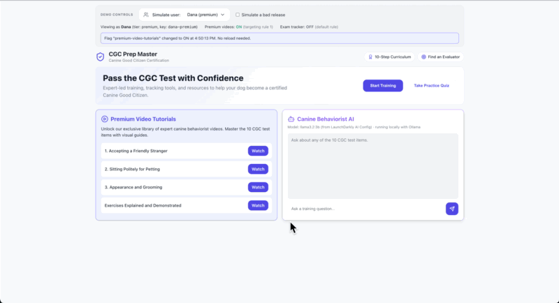

### Remediate a bad release with the trigger

**The situation being simulated:** a new feature ships, it is broken, and it has to be switched off immediately, without a deploy.

1. Make sure the flag is on and pick Dana. Tick **Simulate a bad release**. The card now says "temporarily unavailable" while the rest of the page keeps working: the error boundary ([`FlagBoundary.jsx`](../src/components/FlagBoundary.jsx)) contained the failure, and reported the error to New Relic if you set it up. **Try again** re-runs the broken code and reports another error.
2. Turn the feature off with the trigger, in either of these ways:
   - **With `curl`** (the trigger URL is a secret webhook; it accepts a POST):
     ```bash
     curl -X POST "<the LD_TRIGGER_URL value from your .env>"
     ```
   - **From the browser:** click **Fire kill switch** (visible while the bad release is ticked). The page asks the backend to call the trigger for you.
3. The flag turns off and the broken card disappears for everyone, live. Nothing was deployed.
4. Restore: turn targeting back on in LaunchDarkly and untick **Simulate a bad release**.

What that looks like, in order. The bad release is contained to one card:

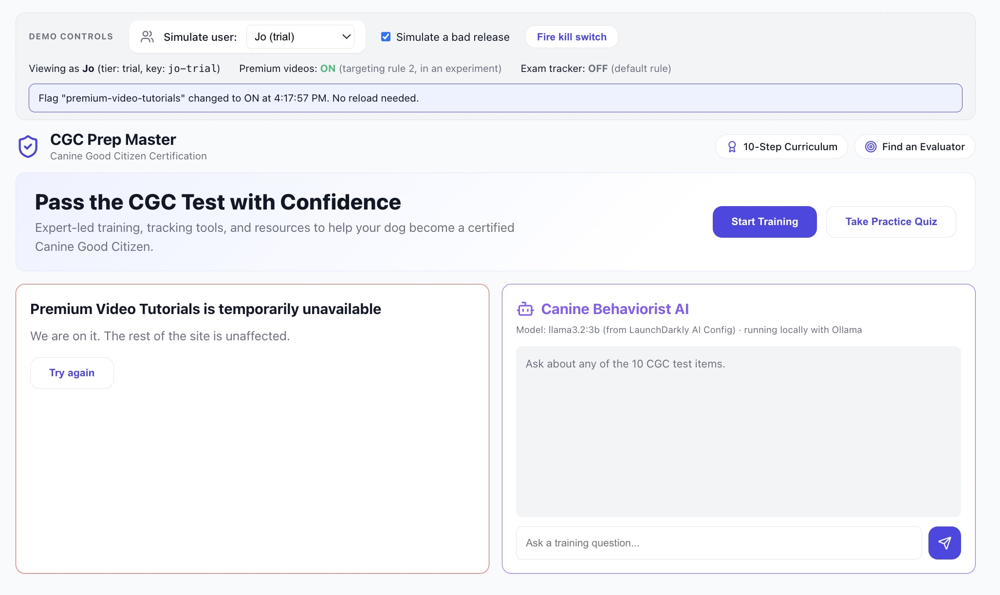

The kill switch fires and the flag turns off (the page reports it live, and the demo bar reads "flag is off"):

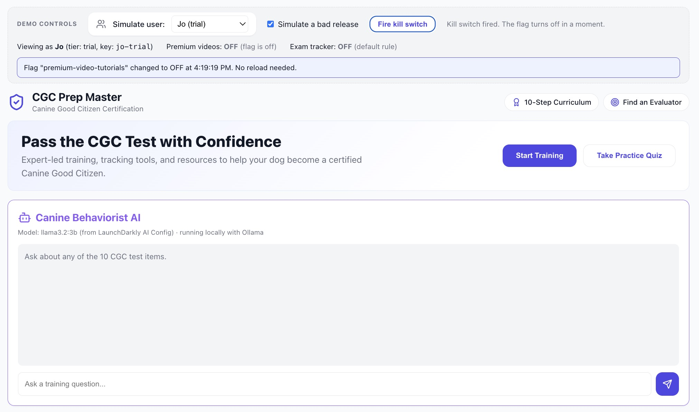

LaunchDarkly records who or what turned the flag off, here the generic trigger:

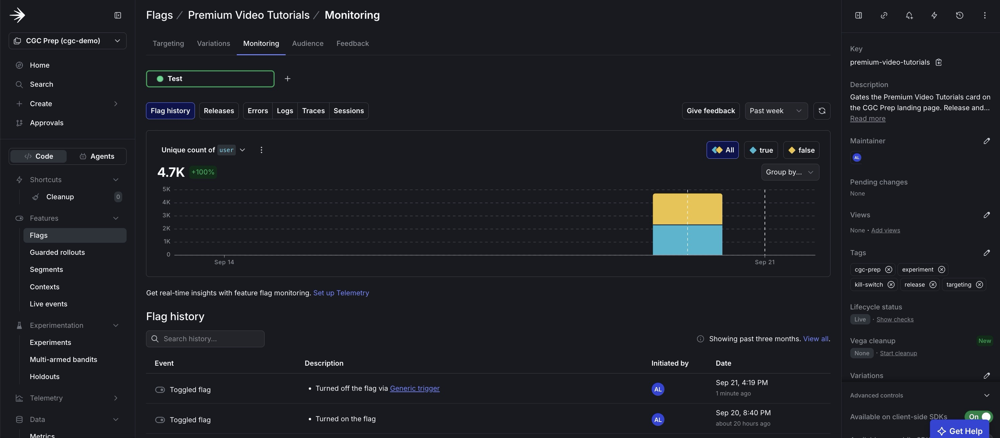

**What "via a browser" means.** A trigger can be fired manually, for example with curl or from a browser. A flag trigger is a webhook URL that accepts a **POST** request, and typing the URL into a browser address bar sends a GET, so it does not work on its own. "Via a browser" therefore means sending that request from a browser-based tool or page. Here the **Fire kill switch** button does it: the browser calls `/api/kill-switch` on the backend, which POSTs to the trigger. (Keeping the trigger URL on the server also keeps the secret out of the page.) A web-based REST client works too.

**If your account has no flag triggers:** turn the flag off through the REST API instead (needs `$LD_API_TOKEN`), which has the same effect:

```bash
curl -X PATCH "https://app.launchdarkly.com/api/v2/flags/cgc-demo/premium-video-tutorials" \
  -H "Authorization: $LD_API_TOKEN" \
  -H "Content-Type: application/json; domain-model=launchdarkly.semanticpatch" \
  -d '{"environmentKey": "test", "instructions": [{"kind": "turnFlagOff"}]}'
```

## Targeting

The context is built in [`src/shared/personas.js`](../src/shared/personas.js): a `user` context with a stable key, a name and the custom attribute `tier`. LaunchDarkly evaluates targeting in this order: **individual targets**, then **rules** top to bottom, then the **default rule**.

1. **Dark launch:** with targeting on and the default rule serving `false`, nobody sees the feature. Switch to Sam: no video card. The status strip says "default rule".
2. **Individual targeting:** on the flag, "Target individuals", add `alex-vip` to `true`. Alex is a *free* user, so the rule below cannot reach him; only individual targeting can. Switch to Alex: the card appears and the strip says "individual target". Sam still sees nothing.
3. **Rule-based targeting:** add a rule "Paying and beta tiers": context kind `user`, attribute `tier`, operator "is one of" `premium`, `beta`, serve `true`. Dana and Maya now see the card ("targeting rule 1"). Sam still does not.

Why Sam matters: to prove targeting works you need someone who does *not* match and sees nothing; otherwise "targeted" looks the same as "on for everyone".

The targeting on the flag in LaunchDarkly: the individual target, the tier rule, then (further down) the trial rule that the experiment uses, and the default rule.

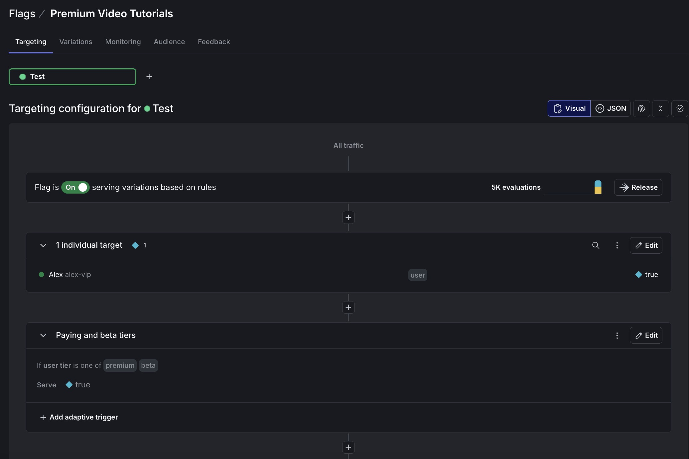

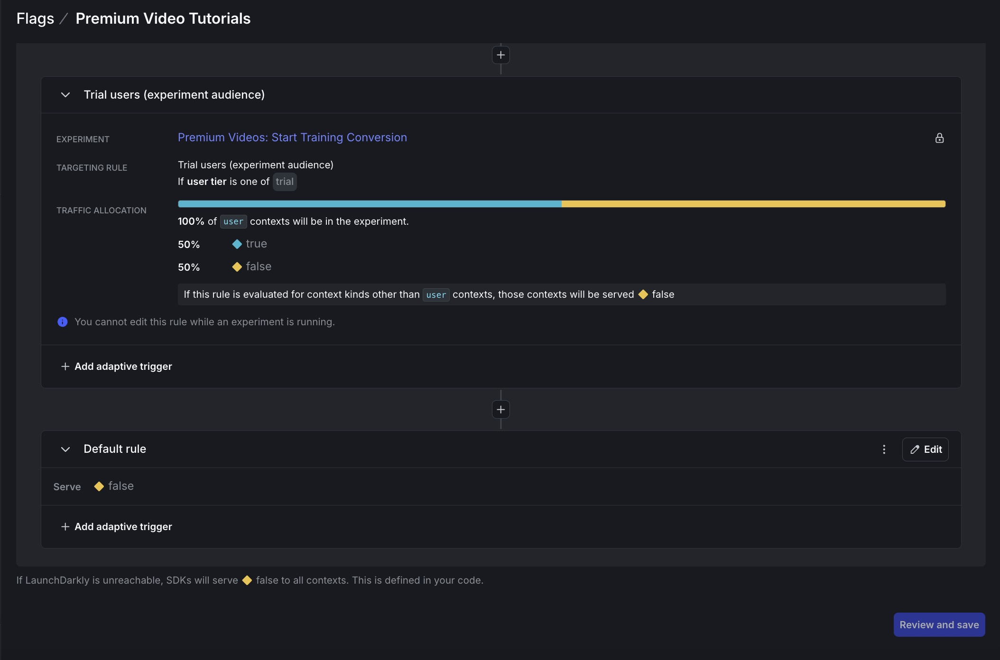

And what each kind of user sees, with the reason LaunchDarkly gave. **Alex** matches the individual target:

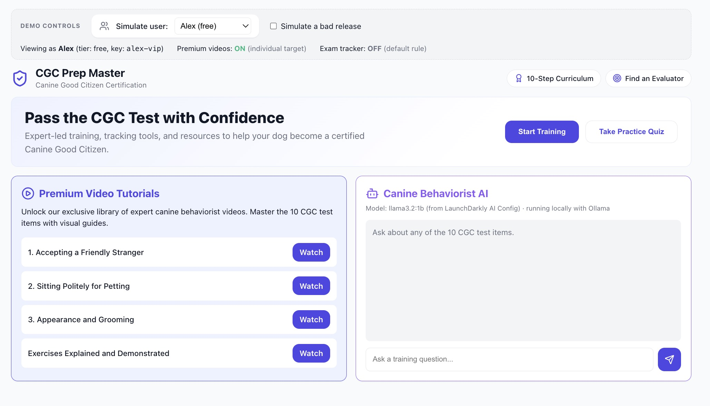

**Dana** matches the tier rule:

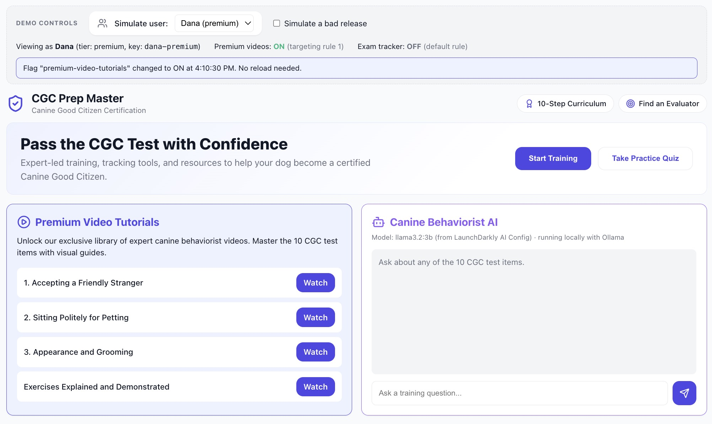

## Experimentation

Targeting decides *who* gets a feature. An experiment decides *whether it is worth releasing*: it randomly splits people into "shown" and "hidden" and measures what they do.

`npm run setup` creates and starts this experiment (and the AI one); running setup again retries it.

### Before the results: two numbers that look alike but aren't

This experiment has two separate numbers in it, and both happen to involve percentages, which is the easy place to mix them up:

1. **The 50/50 split decides who is in which group.** Think of it as a coin flip for each trial user: heads, they see the videos; tails, they don't. This is set up *before* anyone visits the site, and it decides nothing about behaviour, only who ends up in which group. Half of trial users are flipped one way, half the other.
2. **The lift (for example "+40%") is what we're trying to find out: how much MORE the "heads" group did the thing we care about (clicking Start Training), compared with the "tails" group.** It has nothing to do with the coin flip. It is only known once people in both groups have actually clicked, or not, and LaunchDarkly compares the two groups' click rates.

So "50/50" answers *who is in each group*, and "+40%" answers *did the thing we showed them make a difference*. One is a coin flip we control; the other is a real-world result we are measuring.

**Who is in the experiment.** Only trial users (the split above): everyone else is unaffected, so Sam, Alex, Dana and Maya keep seeing exactly what Targeting says they should. In the app the two trial personas are **Jo** and **Riley**; the status strip shows "targeting rule 3, in an experiment" for both. Each of them is one coin flip, so sometimes both land on the same side, which is normal for two people; the simulator's thousands of synthetic visitors are what shows the real 50/50 balance and produces a result worth reading.

<details>
<summary>More on the coin-flip mechanics (click to expand)</summary>

LaunchDarkly hashes each user's key, together with the flag, into one side of the split, and keeps the user there: a persona always gets the same answer, so it's sticky, not a coin flip on every page load. That's what makes it a fair test — a person's experience does not change mid-experiment.

</details>

**Hypothesis:** showing the premium video tutorials increases the rate at which trial users click Start Training.

1. **Metric:** `clicked-start-training` (see [Create the metrics](manual-setup.md#create-the-metrics)). The **Start Training** button sends it.
2. **Rule:** on the flag, the rule "Trial users (experiment audience)": `tier` is one of `trial`, served as a **percentage rollout, 50% `true` / 50% `false`**, with **Start an experiment** chosen on it. Attach the metric.
3. **Start** the experiment. LaunchDarkly only counts events after the iteration starts.
4. **Generate data** with the [simulator](#the-traffic-simulator):
   ```bash
   npm run simulate -- --target flag --users 5000 --base 0.10 --lift 0.04
   ```
5. **Read the result** on the experiment's Results tab (LaunchDarkly analyses in 5-minute steps, so allow a few minutes), then decide: release the feature to everyone (default rule `true`) or keep it dark.

**What you should see** (a few minutes after the script finishes): two treatments, `Videos shown` and `Videos hidden` (the baseline), each with its number of users and its click rate on `clicked-start-training`, and a verdict on whether the difference is real. With `--users 5000 --base 0.10 --lift 0.04` expect roughly 14% against 10%. **Use 5,000 users, not fewer:** with only 2,000, a real difference this size is caught only about 4 times in 5; with 5,000 it is caught almost every time.

### Reading the result: a real example

This is the experiment after `npm run simulate -- --target flag --users 5000` (the defaults, `--base 0.10 --lift 0.04`). To make the demo meaningful, the simulator secretly bakes in a real effect before it starts: **it makes the "shown" group 40% more likely to click** (about 10 in 100 click without the videos, about 14 in 100 click with them). Nobody tells LaunchDarkly this. The question the experiment answers is: *can it find the planted effect from the click data alone, the same way it would have to for a real feature?* **The numbers below show how to read the tool, not how real visitors behave.**

The design, as LaunchDarkly shows it: the hypothesis, the metric, the audience (trial users) and the 50/50 split (this is coin flip #1, deciding who is in which group):

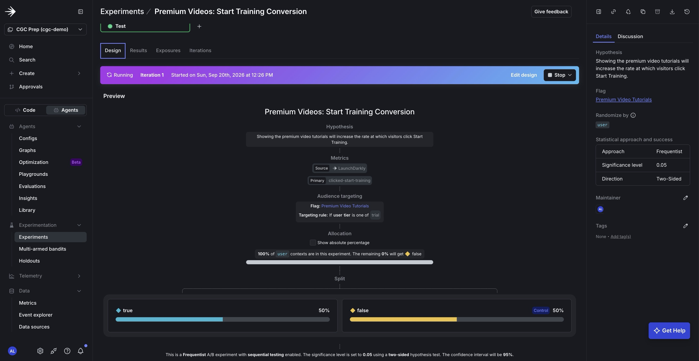

The result, with the tooltip open on `Videos shown`:


| | Videos hidden (baseline) | Videos shown |
|---|---|---|
| Visitors in the experiment | 2,399 | 2,318 |
| Clicked Start Training | 9.92% (about 238) | 14.11% (about 327) |

**In plain terms:** about 10 out of every 100 visitors who did not see the videos clicked Start Training. About 14 out of every 100 who did see them clicked. LaunchDarkly's screenshot calls that a **"relative difference" of +42.20%**: going from 10 to 14 clicks per 100 is 42% more clicks than the group without the videos.

**Where did "40%" come from, if the screenshot says 42%?** It's not on the screenshot at all — it's a setting I chose on the simulator script before running it (`--base 0.10 --lift 0.04`: a 10%-without-videos rate, plus 4 more points with them, so 14%). 4 extra points on a 10% base is 40% more, in the same "relative" terms LaunchDarkly uses. So 40% is the effect **I secretly built into the fake data**, and 42.20% is what LaunchDarkly **measured** from the (randomly generated) clicks, without being told the answer. They're close, which is the whole point of this exercise: it shows the tool can find an effect I know is really there.

**What "even the low end" means.** LaunchDarkly doesn't just give one number (42.20%); it gives a range it's confident the true effect falls in: roughly +20% to +65%. "The low end" is that 20% floor — worded as "a fifth" because 20% is one fifth of 100%. Even in the most cautious reading of the data, visitors who saw the videos clicked about a fifth (20%) more often than those who didn't, and that floor is still above zero, which is why the result counts as a real effect and not noise. **The decision:** release the videos to all trial users, and when estimating impact, plan around that cautious ~20% floor rather than the headline 42%.

<details>
<summary>What "p-value" and "confidence interval" mean, more precisely (click to expand)</summary>

- **p-value (0.0002).** This answers "if the videos truly did nothing, how often would we see a gap this large just from randomness?" Here, about 2 times in 10,000. The bar chosen in advance for "not a fluke" is 1 time in 20 (0.05), so 0.0002 clears it comfortably. LaunchDarkly calls this "statistically significant."
- **Confidence interval (+19.88% to +64.51%).** A single number like "+42%" hides how much of that could be noise. The interval is the range the *true* lift most likely falls in. Because the whole range is above zero, we can be confident the effect is real, even though we can't pin its exact size — anywhere from a fifth more clicks to nearly two-thirds more would all be consistent with this data.
- **Why the interval is wide here.** 2,317 or so people is a fairly small sample for a click rate around 10%. A bigger sample (or a longer-running real experiment) narrows the interval.
- **About the sample sizes shown:** the screenshot counts 4,717 of the 5,000 users sent. An earlier version of the simulator most likely lost some users when the SDK's outgoing-event buffer overflowed; the current version sends events in smaller batches so a run should count everyone. The users that were lost were dropped at random, so the rates above are still valid.

</details>

<details>
<summary>What this result does <em>not</em> prove, and what a real team would check next (click to expand)</summary>

- **Run length.** A real experiment is sized in advance (how many visitors are needed to detect the smallest lift worth caring about), run for whole weeks so weekday and weekend behaviour both count, and not stopped the moment it first looks significant (checking early inflates false positives). This simulator sends everyone at once, so it shows the workflow, not a run long enough to trust for a real decision.
- **One metric.** A click on Start Training is not a purchase. A fuller experiment adds a guardrail metric (for example refunds, or errors on the new card) to confirm nothing else got worse.
- **Who it covers.** Only trial users were in the experiment, so the result speaks for trial users specifically. Extending it to everyone is a separate decision.

</details>

### The traffic simulator

A trial has no real visitors, so [`scripts/simulate-traffic.mjs`](../scripts/simulate-traffic.mjs) sends **synthetic** ones. It is **not** one user repeated: `--users 5000` creates 5,000 different users (`sim-flag-user-0` to `sim-flag-user-4999`), all trial-tier, so each is in the experiment. Each one:

1. evaluates the flag (LaunchDarkly buckets them by their key into shown or hidden, which records the experiment exposure), and
2. clicks Start Training with probability `--base` (10% by default), plus `--lift` (4 points) if they were shown the feature.

Every simulated user has `synthetic: true`. **The results demonstrate the workflow, not real customer behaviour.** The lift is a number you choose. You can add real data by opening the app as Jo or Riley (the experiment personas) and clicking Start Training.

Options: `--target flag|ai`, `--users N`, `--base P`, `--lift P`. It uses `LD_SDK_KEY` from `.env`, so it feeds the environment of that key.

## AI Configs

The chatbot ([`AIChatbot.jsx`](../src/components/AIChatbot.jsx)) calls the backend ([`server/index.js`](../server/index.js)), which reads a LaunchDarkly **AI Config** for the current user, gets a reply from a model, and reports duration, tokens, success and thumbs up/down back to LaunchDarkly.

**What an AI Config does and does not do.** It stores the model and prompt and serves them per user, so you can change both in LaunchDarkly without a deploy. It does not call the model. [`server/llm.js`](../server/llm.js) does, and it takes the model name at its word, with no mapping:
- a model called `gpt-...` runs on **OpenAI** (needs `OPENAI_API_KEY`),
- any other model (`llama3.2:1b`) runs on **Ollama**, a free tool that runs models on your own machine,
- if that model is not available, you get **canned replies**, so the demo still runs on a bare checkout.

The line above the chat says which of the three is answering.

### Local models with Ollama (about 3.3 GB, works offline)

`npm run setup -- --install-ollama` installs Ollama with Homebrew on macOS, starts it and downloads the models. By hand:

```bash
brew install ollama          # or download from https://ollama.com/download
ollama pull llama3.2:1b      # about 1.3 GB
ollama pull llama3.2:3b      # about 2 GB
```

**Ollama has to be running for the chatbot to use these models.** On macOS the Ollama app starts its server automatically; if you installed only the command line tool (for example with `brew install ollama`), run `ollama serve` in a separate terminal and leave it open. Small local models are slower and less accurate than cloud ones, which is fine for a demo. The backend loads both models when it starts (a cold model can take 10 to 30 seconds), so wait for `Local models ready` in its log before the first message.

### The AI Config

`npm run setup` (Terraform, see `terraform/main.tf`) creates:
- two **model configs**, because LaunchDarkly's model catalog lists cloud models: `Llama 3.2 1B (Ollama)` with model id `llama3.2:1b` and `Llama 3.2 3B (Ollama)` with `llama3.2:3b`;
- the AI Config `canine-coach-chatbot` with two variations:
  - `Concise`: the 1B model, system message "You are a concise Canine Good Citizen coach. Answer in one or two sentences."
  - `Detailed`: the 3B model, system message "You are an expert canine behaviorist specializing in the AKC Canine Good Citizen test. Explain the reasoning behind each test item and give step by step training advice."

The script then serves the two variations 50/50 by default and starts the experiment below.

**By hand:** in LaunchDarkly open **AI Configs** (in the sidebar under **Agents**; AI Configs do not appear in the Flags list). Add the two custom model configs (provider `ollama`, model ids as above), create a **completion** config with key `canine-coach-chatbot`, add the two variations, and on its **Targeting** tab serve one variation (or a 50/50 split). Chat in the app. Switch the served variation in LaunchDarkly: within about 3 seconds the line above the chat shows the new model, and the next reply changes. To change one persona only, add an individual target for it on the AI Config.

**To try OpenAI instead** (needs `OPENAI_API_KEY` in `.env`): create a model config for `gpt-4o-mini`, point a variation at it, and the backend calls OpenAI for that variation. Ollama and OpenAI are never mixed: each model runs where its name says.

### Experiment: which prompt and model works best?

The AI Config in LaunchDarkly holds both variations: each is a prompt plus a model.

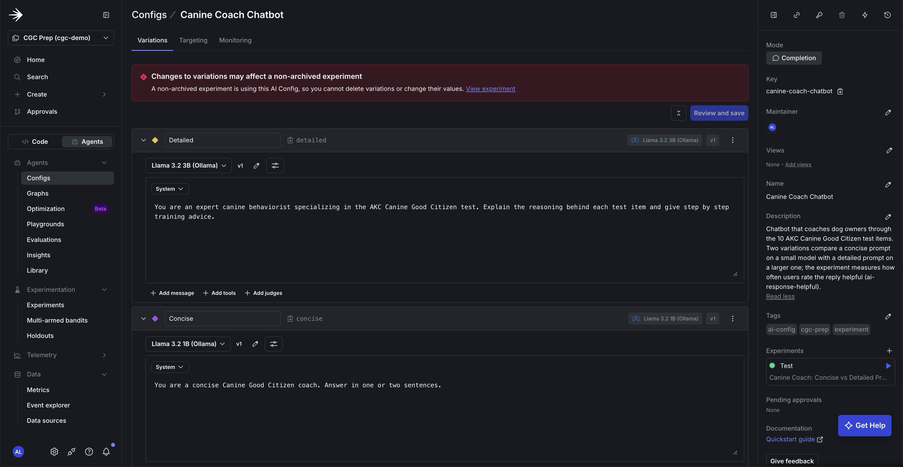

The same question to two users gives two different answers. **Sam** was served `Concise` (the small model, a short reply):

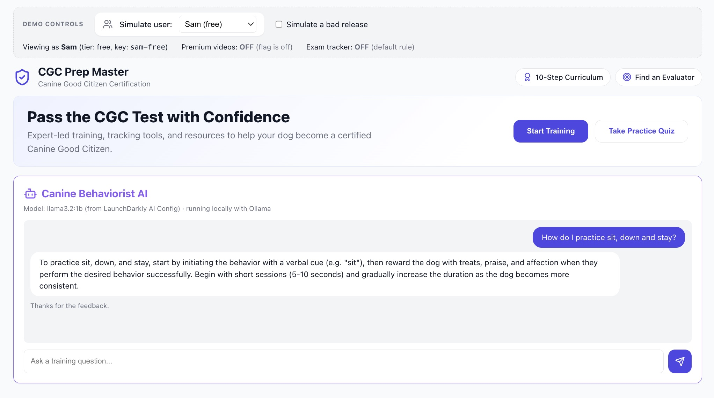

**Dana** was served `Detailed` (the larger model, a step-by-step reply):

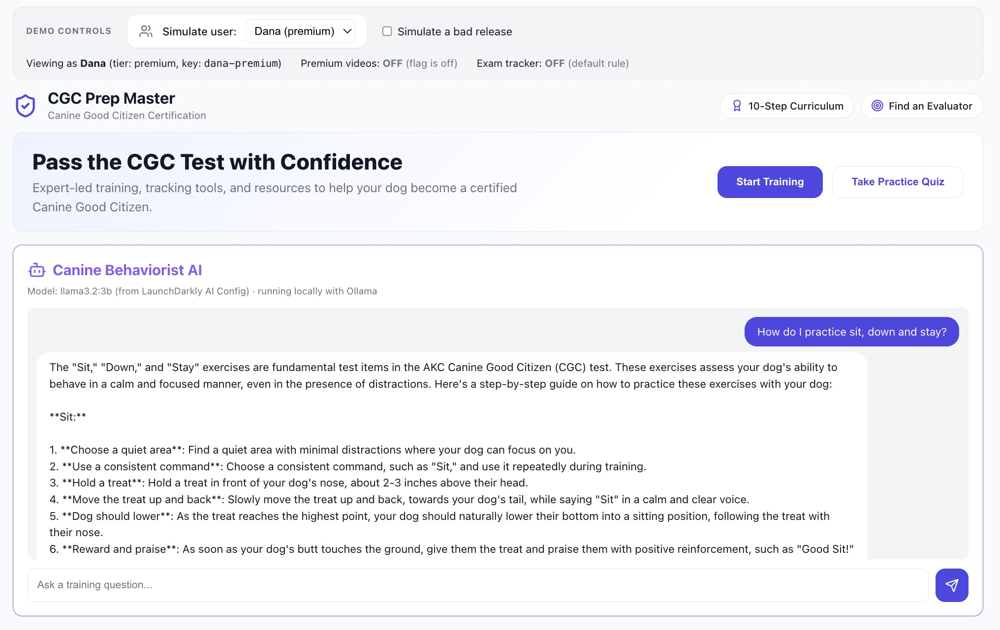

(Which user gets which variation is decided by a hash of their key, so in your project the two may be swapped.)

**Why different personas get different models.** Just like the videos experiment, there's a 50/50 coin flip (which model does this person get?) and, separately, a result we're measuring (did they find the reply helpful?). The coin flip here is a hash of the user's key, so it's random but sticky: a persona keeps its variation every time, and it has nothing to do with `tier`. In the app all six personas are exposed as soon as the chat loads, so you can see both variations without waiting for the simulator.

`npm run setup` sets this up for you. By hand:

1. Set the AI Config's default rule to a **50/50 percentage rollout** of `Concise` and `Detailed`.
2. Create an experiment on the AI Config with the custom metric `ai-response-helpful` (a thumbs up). Hypothesis: *the detailed prompt on the larger model earns more thumbs-up.* Start it.
3. Generate data with real clicks (chat, then click **Yes** or **No**) or the simulator: `npm run simulate -- --target ai --users 2000 --base 0.50 --lift 0.10`.

**Reading the result: a real example.** This is after `npm run simulate -- --target ai --users 2000 --base 0.50 --lift 0.10`. As with the videos, the simulator secretly plants a real effect before it starts: replies from `Detailed` are marked helpful 60% of the time, against 50% for `Concise`, a 20% lift. The thumbs-up is synthetic, so this shows the workflow, not real users' opinions.

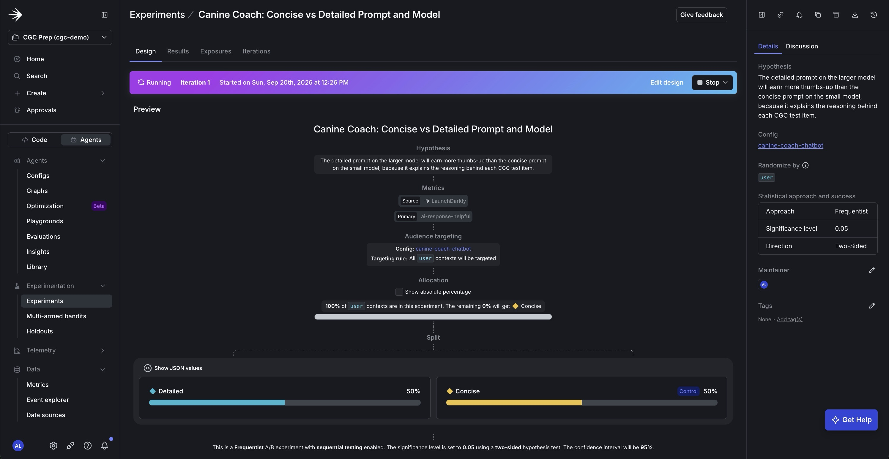

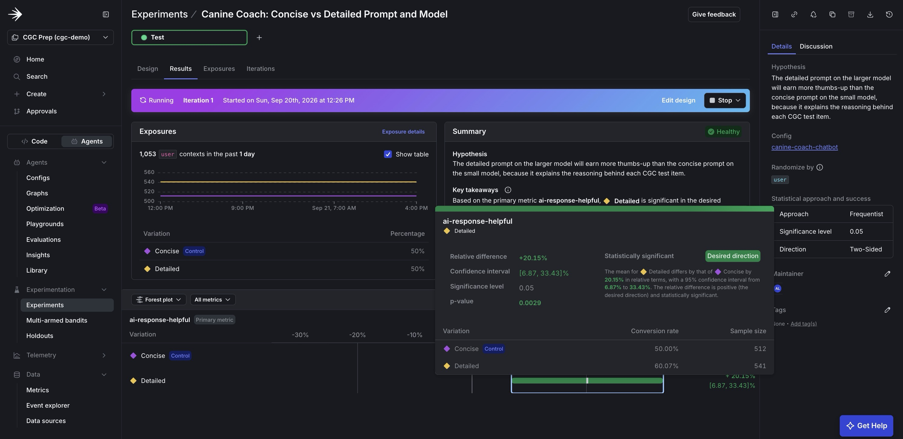

| | Concise (baseline, `llama3.2:1b`) | Detailed (`llama3.2:3b`) |
|---|---|---|
| Users | 512 | 541 |
| Replies marked helpful | 50.00% (about 256) | 60.07% (about 325) |

**In plain terms:** half of the people who got the short answer said it was helpful; six in ten of the people who got the detailed answer said the same. That's 20% more people finding it helpful, which matches the 20% effect that was planted, so the tool found it correctly. LaunchDarkly's safe range for the true effect is roughly +7% to +33%, never as low as zero, so `Detailed` really is better. **The decision:** make `Detailed` the default, and stop the experiment. Two things to keep in mind before shipping that:

- **Prompt and model changed together.** The experiment shows the *bundle* wins. It cannot say whether the prompt or the larger model did the work. To find out, run a follow-up with one change at a time.
- **Thumbs-up is not the whole picture.** A larger model is usually slower and costs more. A real decision weighs the 20% gain against those too.

<details>
<summary>The same numbers, more precisely (p-value, confidence interval, sample size — click to expand)</summary>

- **p-value 0.0029:** about 3 chances in 1,000 that a gap this size is just luck, well under the 1-in-20 bar for "statistically significant".
- **Confidence interval +6.87% to +33.43%:** the range the true effect most likely falls in. The whole range is positive.
- **Sample size:** the screenshot counts 1,053 of the 2,000 users sent, for the same reason as the videos experiment — an earlier version of the simulator could lose events under load. The rates shown are still valid; see the [videos experiment](#reading-the-result-a-real-example) for the full explanation.

</details>

### Questions to ask the chatbot

With a real model ask anything about the test: "How do I teach loose leash walking?", "My dog jumps on strangers, what should I do?", "How do I practise sit, down and stay?", "What does the evaluator do in the grooming exercise?". With canned replies the answer keys off these words: stranger, petting, grooming, loose leash, crowd, sit/down/stay, recall, another dog, noise, alone. Anything else returns the list of the 10 test items.

If the AI Config is switched off, the chatbot shows "Assistant is switched off".

## Optional second flag scenario: gradual rollout

The `exam-progress-tracker` flag controls the **Exam Progress Tracker** card and shows a different targeting pattern:

1. Flag `exam-progress-tracker` (created by `npm run setup`) has one rule "Beta testers": `tier` is one of `beta`, serve `true`, and a default rule of `false`. Only Maya sees the tracker.
2. **Gradual rollout:** change the default rule to a percentage rollout, for example 25% `true`, then 50%, then 100%. Non-beta users are bucketed by their context key, so each persona stays in the same group as the percentage grows.
